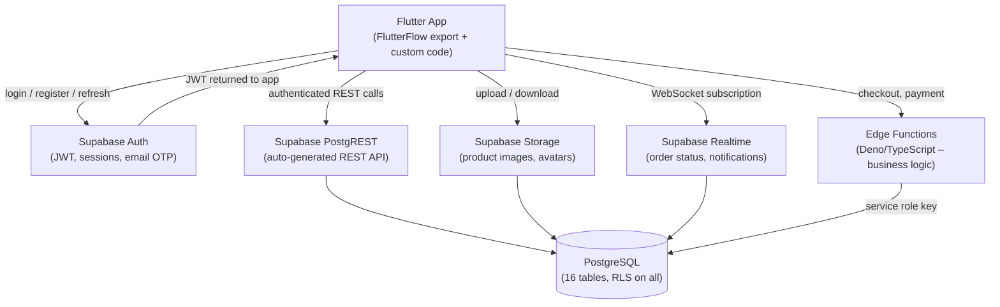
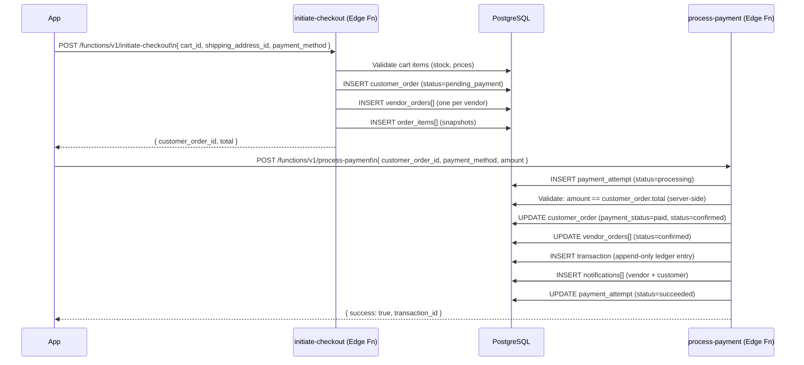

# SaloneMarket — System Architecture

## Overview

SaloneMarket is a multi-vendor mobile commerce platform targeting Sierra Leone. It is built on a Flutter/FlutterFlow mobile client backed entirely by Supabase (PostgreSQL, Auth, Storage, Realtime, Edge Functions).



---

## Three-Tier Architecture

| Tier | Technology | Responsibility |
|---|---|---|
| **Presentation** | Flutter (FlutterFlow export + custom Dart) | UI rendering, state display, user input |
| **API / Logic** | Supabase PostgREST + Edge Functions | Data access rules (RLS), server-side business logic |
| **Data** | PostgreSQL (hosted by Supabase) | Persistence, constraints, triggers, audit log |

The client tier is **untrusted by default**. All writes are validated by Row Level Security policies. Payment-critical writes (transactions, order status changes from `pending_payment` → `confirmed`) are performed exclusively by Edge Functions using the service role key, never by the client directly.

---

## Role Architecture

### Roles

| Role | Assigned By | Capabilities |
|---|---|---|
| `customer` | Default on registration | Browse, cart, checkout, review, track own orders |
| `vendor` | Admin approval of a vendor application | Manage own shop, products, inventory; fulfil vendor_orders |
| `admin` | Supabase dashboard (manual) | Full platform management; approve vendors; moderate products |

### Role Assignment & Protection

- `profiles.role` defaults to `'customer'` on row creation.
- A database **trigger** (`trg_protect_role`) prevents any direct UPDATE to `profiles.role` by non-admin users. Even if a customer crafts a raw PostgREST PATCH request, the trigger blocks elevation.
- RLS policies on `profiles` allow users to read their own row but not update `role` or `is_active`.
- Vendor status is managed through the separate `vendors` table (`status` column), not through `profiles.role` alone.

### Routing Model

```
/ (root)
├── /auth/login
├── /auth/register
├── /customer/*        (requires role=customer or vendor)
│   ├── /home
│   ├── /search
│   ├── /product/:id
│   ├── /cart
│   ├── /checkout
│   ├── /orders
│   └── /profile
├── /vendor/*          (requires role=vendor + vendor.status=active)
│   ├── /dashboard
│   ├── /products
│   ├── /orders
│   └── /settings
└── /admin/*           (requires role=admin)
    ├── /users
    ├── /vendors
    ├── /products
    └── /config
```

GoRouter redirect guards check JWT claims and profile role on every deep link. Unauthenticated users are always redirected to `/auth/login`.

---

## Multi-Vendor Order Architecture

### Design Principle

A customer places **one order** even when buying from multiple vendors. The platform then splits that order per vendor for independent fulfilment. Financial records are immutable and server-authoritative.

### Table Roles

| Table | Who sees it | Purpose |
|---|---|---|
| `customer_orders` | Customer, Admin | The customer's view: total amount, payment status, delivery address |
| `vendor_orders` | Vendor (own only), Admin | Each vendor's fulfilment slice: their items, their status |
| `order_items` | Customer (read), Vendor (read own), Admin | Immutable snapshot of product name, price, vendor at time of order |
| `payment_attempts` | Admin, Edge Functions | Every payment attempt, including failures (audit trail) |
| `transactions` | Admin, Edge Functions | Confirmed financial movements — append-only ledger |

### Order Item Immutability

`order_items` stores `product_name`, `vendor_name`, `unit_price` as plain text/numeric fields captured at checkout time. If a vendor later edits a product's price or name, historical orders are unaffected. The `product_id` FK is retained for reference but is not the source of truth for the displayed price.

### Payment Flow Sequence



---

## FlutterFlow Integration Model

### Branch Strategy

| Branch | Owner | Purpose |
|---|---|---|
| `main` | Developers (reviewed) | Production source of truth |
| `flutterflow/export` | FlutterFlow auto-sync | Raw FF output — **never manually edited** |
| `feature/*` | Developers | New features, branched from `main` |

### Why Never Direct-Merge `flutterflow/export` → `main`

FlutterFlow exports regenerate all files in `lib/` on every sync. Without review, this would silently overwrite custom code. All merges from `flutterflow/export` go through a PR that must pass the diff checklist before merging.

### Custom Code Preservation

FlutterFlow preserves files it did not generate, but the developer workflow must be disciplined:

- **`lib/custom_code/actions/`** — Custom Dart actions called from FF action flows. FF will not overwrite these but may add new stub files.
- **`lib/custom_code/widgets/`** — Custom Flutter widgets embedded in FF screens.
- **`lib/core/`** — Shared utilities, constants, theme, services. FF never touches this directory.

> **Rule:** Never place business logic or design token definitions inside FF-generated widget files. They will be lost on the next export.

### State Management

| Concern | Technology |
|---|---|
| Authentication state | `Provider` + `AuthService` class (custom code) |
| User profile | `Provider` — loaded after login, cached in memory |
| Realtime order status | `Supabase.instance.client.from('vendor_orders').stream(...)` |
| Realtime notification count | `Supabase.instance.client.from('notifications').stream(...)` |
| Navigation | `go_router` with redirect guards |
| Cart state | Local `Provider` + write-through to `carts`/`cart_items` table |

### Realtime Subscriptions

```dart
// Order status (vendor dashboard)
Supabase.instance.client
  .from('vendor_orders')
  .stream(primaryKey: ['id'])
  .eq('vendor_id', currentVendorId)
  .order('created_at', ascending: false)
  .listen((data) { /* update UI */ });

// Notification count (all roles)
Supabase.instance.client
  .from('notifications')
  .stream(primaryKey: ['id'])
  .eq('recipient_id', currentUserId)
  .eq('is_read', false)
  .listen((data) { notificationCount.value = data.length; });
```

Subscriptions are established after login and disposed on logout.

---

## Security Model Summary

| Layer | Mechanism |
|---|---|
| Transport | HTTPS everywhere (Supabase enforces TLS) |
| Authentication | Supabase Auth JWTs, 1-hour expiry, auto-refresh |
| Data access | Row Level Security on all 16 tables |
| Role protection | Database trigger blocks self-elevation |
| Payment integrity | Server-side amount validation in Edge Function |
| Secrets | Service role key only in Edge Function `Deno.env` |
| Client trust | Client is untrusted — cannot write transactions or mark orders paid |

See [security.md](security.md) for the full security model.
